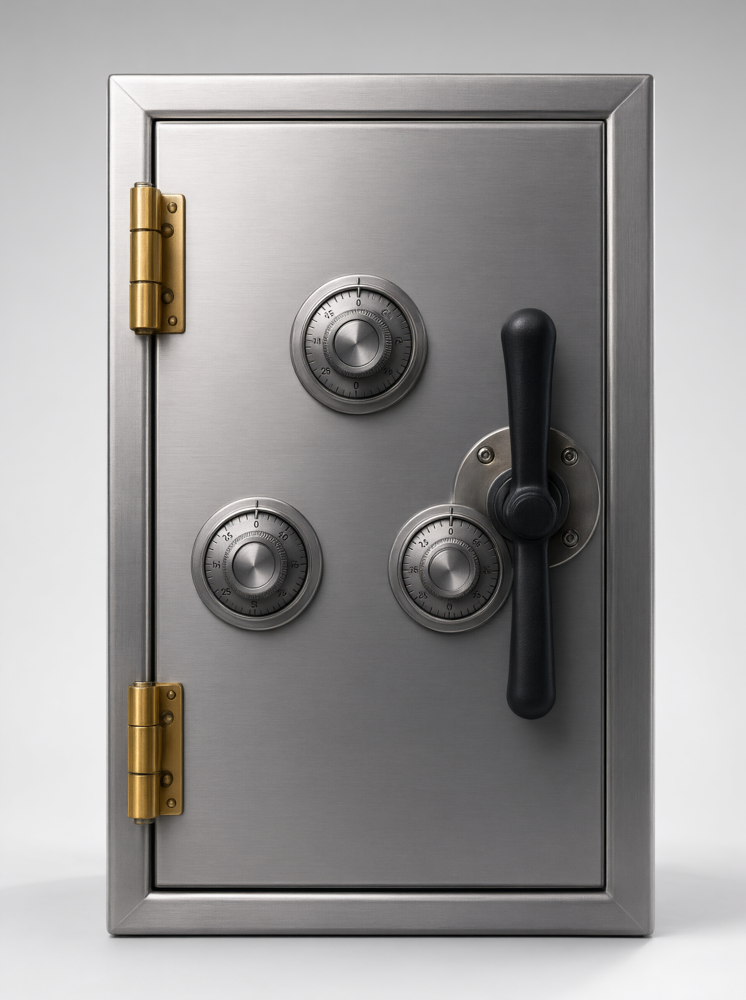

# 🔐 Safecracker

**Браузерная головоломка-сейф**: соберите правильный код, вращая лимбы и перетаскивая центральный лимб. Чистый HTML/CSS/JS без зависимостей и сборки.

<p align="center">
  
</p>

---

## 🎮 Как играть

**Цель:** собрать на панели «Панель» три цифры, совпадающие с панелью «Код».

- На поле **три лимба** — верхний, правый и левый. Они вращаются вокруг центра.
- **Центральный лимб** перетаскивается мышью или пальцем.
  - В **центре** — ни с кем не соединена, цифры вращать нельзя.
  - На **орбите** — соединяется с двумя ближайшими лимбами.
- Вращать цифры можно **только у тех лимбов**, к которым подключена солнечная шестерёнка.
- Чтобы подключить другие лимбы — перетащите шестерёнку в другую позицию.

### Управление (крестовина)

| Кнопка | Действие |
|---|---|
| Верхняя ⟳ | Повернуть весь механизм по часовой стрелке |
| Нижняя ⟲ | Повернуть весь механизм против часовой стрелки |
| Правая ⟳ | Вращать цифры соединённых лимбов по часовой |
| Левая ⟲ | Вращать цифры соединённых лимбов против часовой |
| Центральная ↺ | Начать заново |

### Победа

Когда активные цифры совпадут с кодом, штурвал в центре подсветится. Если солнечная шестерёнка на орбите — перетащите её в центр, затем нажмите на штурвал.

---

## ⚙️ Сложность

| Уровень | Цифр на лимбе |
|---|---|
| 1 | 3 |
| 2 | 4 |
| 3 | 5 |
| 4 | 6 |

Выбор сохраняется в `localStorage` (`safecracker_difficulty`).

---

## 📊 Статистика

Для каждого уровня сохраняется:

- количество игр;
- количество побед;
- лучший результат (ходы);
- лучшее время.

Хранится в `localStorage` (`safecracker_stats`). Сбросить можно на странице «Статистика».

---

## 🚀 Запуск

Проект не требует сборки и зависимостей. Достаточно открыть `index.html` в браузере.

Для локального сервера (рекомендуется из-за относительных путей и `localStorage`):

```bash
# Python 3
python -m http.server 8000

# Node.js (npx)
npx serve .
```

Затем откройте [http://localhost:8000](http://localhost:8000).

---

## 🛠️ Технологии

- **HTML5 / CSS3** — Grid, Flexbox, анимации, адаптивность.
- **Vanilla JavaScript (ES6+)** — без фреймворков.
- **SVG** — игровое поле, лимбы, шестерёнка.
- **Web Audio API** — синтез звуковых эффектов (без аудиофайлов).
- **Canvas** — салют на экране победы.
- **localStorage** — сложность, статистика, настройка звука.

---

## 📁 Структура проекта

```
├── index.html              # Стартовый экран
├── pages/
│   ├── menu.html           # Главное меню
│   ├── difficulty.html     # Выбор сложности
│   ├── game.html           # Игровой экран
│   ├── rules.html          # Правила
│   ├── stats.html          # Статистика
│   └── victory.html        # Экран победы
├── style/                  # CSS по страницам
│   ├── common.css
│   ├── menu.css
│   ├── difficulty.css
│   ├── game.css
│   ├── rules.css
│   ├── stats.css
│   └── victory.css
├── script/                 # JS-логика
│   ├── game.js             # Основная игровая логика + звук
│   ├── menu.js
│   ├── difficulty.js
│   ├── stats.js
│   ├── victory.js
│   └── ui-sound.js         # Звук для вспомогательных страниц
└── imag/
    ├── background.png
    └── victory.png
```

---

## 🔊 Звук

Звуковые эффекты синтезируются через **Web Audio API** — никаких аудиофайлов. Звук отключается кнопкой 🔊 на игровом экране; состояние сохраняется в `localStorage` (`safecracker_sound_enabled`).

---

## 📱 Адаптивность

Интерфейс рассчитан на мобильные устройства и десктоп. Поддерживаются touch-события для перетаскивания шестерёнки. Игровое поле масштабируется под экран.

---

## 🌐 GitHub Pages

Репозиторий готов к публикации через GitHub Pages:

1. **Settings** → **Pages**
2. Source: **Deploy from a branch**
3. Branch: `main`, Folder: `/ (root)`
4. Сохранить

Игра будет доступна по адресу `https://andreybond77.github.io/Safecracker /`.

---

## 📄 Лицензия

MIT — используйте, форкайте и улучшайте.
